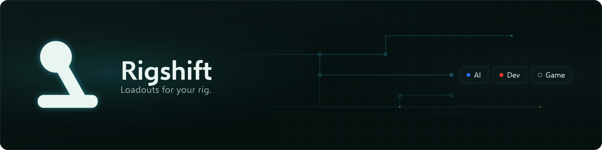
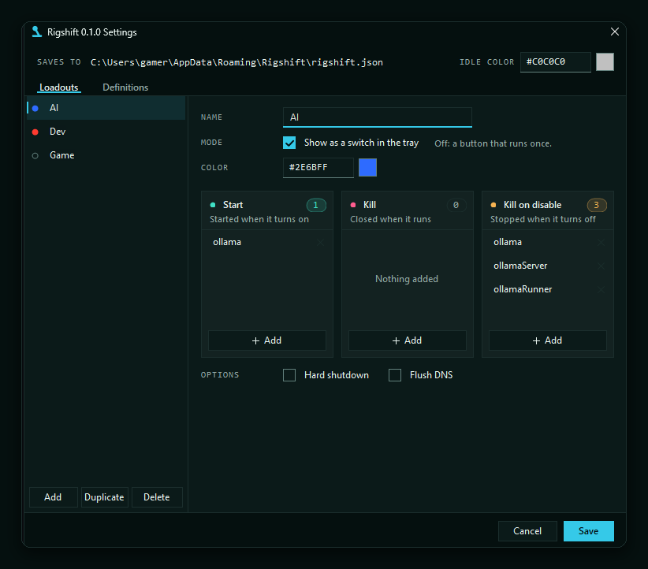
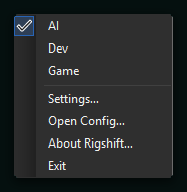

<p align="center">
  
</p>

# Rigshift

[](https://github.com/JohnSaunders/Rigshift/actions/workflows/ci.yml)

A Windows tray app that switches your machine between **loadouts**: named sets of apps to start or stop together. Use one for a streaming setup, another for photo editing, another for a local model. Switching one off stops what it started, so the GPU and memory are free when the next thing needs them. Pick a loadout from the tray, and Rigshift starts and stops everything in it.

<p align="center">
  
  &nbsp;
  
</p>

## Install

Download `Rigshift-Setup-<version>-x64.exe` from the [latest release](https://github.com/JohnSaunders/Rigshift/releases) and run it. Setup is per-machine: it asks for administrator rights once, installs only to `C:\Program Files\Rigshift`, and adds a Start menu entry. You can choose **Start Rigshift when anyone signs in**, and **Launch Rigshift** when setup finishes (the tray starts unelevated). Uninstall from Settings → Apps; your config in `%APPDATA%\Rigshift` is kept. To upgrade, run the newer setup. If the tray is running, exit it first (setup will ask).

The installer is not code-signed, so Windows SmartScreen will warn you the first time. Choose **More info** → **Run anyway**. `SHA256SUMS.txt` on the release page carries the SHA-256 of both downloads if you would rather verify them first.

**Portable zip.** `rigshift-win-x64.zip` from the same release is the same self-contained 64-bit build — unzip it, run `Rigshift.exe`, and keep the files together. Put that folder where the Users group cannot write, not under your profile or `C:\`: a user-writable exe can be replaced, and a later approved prompt would run that swap as administrator.

## Quick start

Right-click the tray icon to switch loadouts. With no config file, the built-in AI, Dev, and Game samples are used. `Settings…` (or a double-click on the icon) edits loadouts; `Open Config…` opens the JSON file. A second launch exits quietly (`Rigshift.SingleInstance`).

If you installed from the zip and want it at login, add a shortcut to your Startup folder. If you later switch to the setup program, delete `Rigshift.lnk` from that folder so it does not clash with the installer's sign-in task.

## Your own loadouts

AI, Dev, and Game are only samples. A loadout is any named group of programs you want started or stopped together. You can create as many as you like, mix any definitions, set each loadout as a **toggle** (stays on until you switch it off) or a **one-shot** (runs once), and pick a tray-icon colour.

A definition can be an ordinary app (any executable, or a shortcut), WSL, a process inside WSL with an optional port proxy, or a `herdr` server, whose teardown needs administrator rights. The same definition can belong to more than one loadout; turning one off leaves the program running if another still needs it.

Add and edit loadouts in Settings, or in the JSON file. This toggle starts OBS and Discord together — point `path` at the exe or a shortcut on your machine:

```json
{
  "definitions": {
    "obs":     { "kind": "app", "processName": "obs64",   "path": "%PROGRAMFILES%\\obs-studio\\bin\\64bit\\obs64.exe" },
    "discord": { "kind": "app", "processName": "Discord", "path": "%LOCALAPPDATA%\\Discord\\Discord.exe" }
  },
  "loadouts": [
    { "name": "Streaming", "toggle": true, "color": "#9146FF", "start": ["obs", "discord"], "killOnDisable": ["obs", "discord"] }
  ]
}
```

An `app` definition cannot take arguments. If you need flags, use a shortcut.

Stopping an `app` uses `taskkill /f`, equally for the built-in loadouts and for
loadouts you write: the process ends immediately, and unsaved work in it is lost
with no save prompt. Rigshift never saves your work first.

## Built-in loadouts

| Loadout | Mode | Colour | What it does |
|---|---|---|---|
| **AI** | Toggle | `#2E6BFF` | Starts native Windows Ollama. Turning it off stops the Ollama tray app, the `ollama` server, and its `llama-server` runner. |
| **Dev** | Toggle | `#FF3B30` | Ensures WSL is running. Turning it off shuts WSL down. |
| **Game** | One-shot | — | Runs once: force-kills Node processes, stops Ollama, shuts WSL down, force-stops the WSL service, and flushes DNS. Open editors are left alone. |

If you use AI, install [Windows Ollama](https://ollama.com/download). For the AI
toggle to be the thing that starts Ollama, nothing else should start it — remove
any shortcut or scheduled task of your own that launches it at sign-in.

## Configuration

Config is re-read whenever the tray menu opens. The first file that exists is used:

1. `%APPDATA%\Rigshift\rigshift.json` — the per-user file, written by Settings
2. `rigshift.json` beside `Rigshift.exe` — optional, for a portable copy
3. Built-in defaults, matching [`Rigshift/rigshift.example.json`](Rigshift/rigshift.example.json)

`//` comments and trailing commas are accepted in the file you edit. Settings always saves the per-user path, and keeps a `rigshift.json.bak` when it replaces that file. The [configuration guide](docs/configuration.md) has the full field reference, elevation behaviour, and known limitations; [design notes](docs/design-notes.md) explain why the boundaries are where they are.

## Build from source

Windows 10 or 11 and the [.NET 10 SDK](https://dotnet.microsoft.com/download/dotnet/10.0). Run `dotnet build -c Release` and `dotnet test`, then launch `Rigshift\bin\Release\net10.0-windows\Rigshift.exe` — not `dotnet run`, because admin steps re-launch the exe. `Rigshift.slnx` opens in Rider or Visual Studio. See [CONTRIBUTING.md](CONTRIBUTING.md).

A `v*` tag publishes `rigshift-win-x64.zip` and `Rigshift-Setup-<version>-x64.exe`. To build the installer locally, install Inno Setup 6.7.1 and run `installer\build.ps1`.

## License

MIT. See [LICENSE](LICENSE).

Bundled third-party assets and their licences are listed in
[THIRD-PARTY-NOTICES.md](THIRD-PARTY-NOTICES.md). To report a security problem,
see [SECURITY.md](SECURITY.md).
